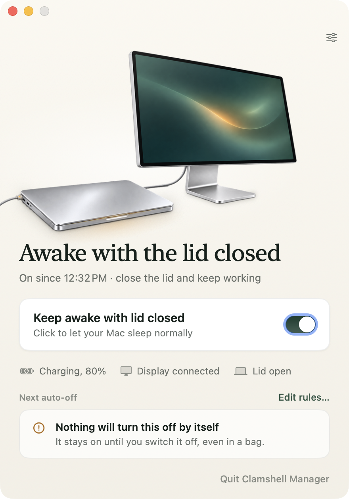
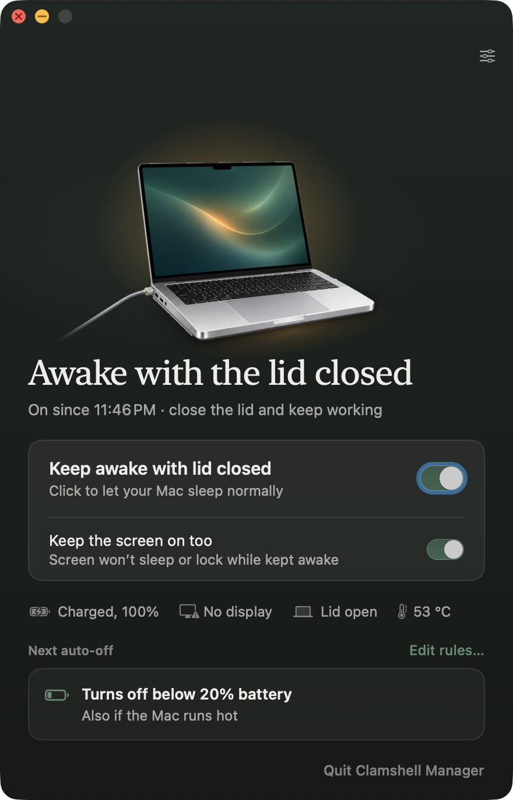
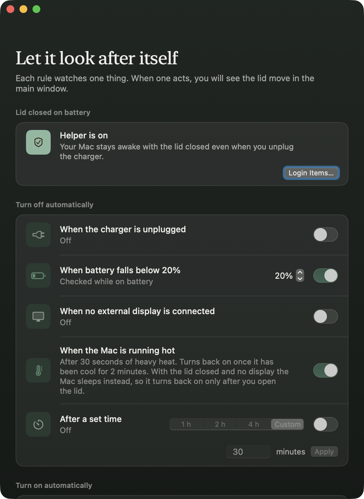

<div align="center">

<picture>
  <source media="(prefers-color-scheme: dark)" srcset="assets/hero-dark.png">
  
</picture>

# Clamshell Manager

**Close the lid. Keep working.**

A quiet menu bar app for MacBooks that keeps your Mac awake with the lid closed,
with rules that turn it off again before anything goes wrong. Made by [Evenpine](https://evenpine.com).

Free to use &middot; not open source &middot; macOS 13 Ventura or later &middot; Apple silicon

[What it does](#what-it-does) &middot; [Install](#install) &middot; [First run](#first-run) &middot; [Rules](#rules) &middot; [Helper](#the-optional-helper) &middot; [Privacy and safety](#privacy-and-safety) &middot; [Changelog](CHANGELOG.md)

</div>

> **Status: pre-release.** This repository is the home for Clamshell Manager's downloads and update
> feed. It is private until the first notarized release. Until then the Releases page is empty.

## What it does

Clamshell Manager lets a MacBook stay awake with its lid shut: run a build, keep a download going,
drive an external display, or let a long job finish in your bag. One switch turns it on. A small
set of rules turns it off for you when the battery runs low, the charger is pulled, the display is
unplugged, the Mac runs hot or a timer runs out, and brings it back when conditions are right again.

- **No password to switch it on or off.** The basic method needs no root, no `sudo` and no `pmset`.
- **Optional helper for battery.** A privileged helper, approved once in System Settings, keeps the
  Mac awake with the lid closed on battery too.
- **Rules that look after themselves**, including resume on charger and a scheduled wake after a
  heat off.
- **Live status:** power, display, lid, thermal state and the CPU temperature.
- **Fails safe.** Quit, a crash or `kill -9` all restore normal lid sleep.





The menu bar item is always there, and closing the window never quits the app.

## Install

1. Download the latest `ClamshellManager-<version>.dmg` from [Releases](../../releases).
2. Open the disk image and drag **Clamshell Manager** to **Applications**.
3. Open it. Releases are signed and notarized by Apple before they are published here.

There is no download yet. The first one appears after Apple notarization, and this page and
[evenpine.com/clamshell-manager](https://evenpine.com/clamshell-manager/) will say so when it does.

Requirements:

- macOS 13 Ventura or later
- A Mac with Apple silicon. The build is arm64 only, and the temperature readout uses the Apple
  silicon IOHID sensors (M1 through current chips)

Clamshell Manager is distributed directly, not through the Mac App Store.

## First run

1. Open the app. It lives in the menu bar, and the main window opens the first time.
2. Flip **Keep awake with lid closed**. No password is asked.
3. Close the lid. With the charger and an external display attached, the Mac keeps running.
4. Open Settings to choose which rules turn keep-awake off for you. To keep the Mac awake on
   battery, set up the helper (see below).

## Rules

Rules live in Settings.

| Rule | What it does | Default |
|---|---|---|
| **Battery** | Turns off below N% battery while on battery (5 to 95%). Manual on is refused below the threshold. | on, 20% |
| **Unplug** | Turns off when the charger is unplugged. | on |
| **No display** | Turns off when no external display is connected. | off |
| **Heat** | Turns off when the Mac runs hot (thermal state serious or critical for 30 s). | on |
| **Timer** | Turns off after a duration (1 h, 2 h, 4 h or custom). A wall-clock deadline, restarted by a manual on. | off, 2 h |
| **Docked** | Turns on automatically when the charger and a display are both connected. | off |

- **Manual off always wins.** For the unplug, no-display and heat rules, a manual on acts as an
  override until that input changes.
- **Resume on charger** (always on): after an automatic off by the battery or unplug rule,
  connecting the charger turns keep-awake back on. Any manual change cancels it.
- **Resume when cool:** after a heat off, keep-awake comes back once the Mac has been nominal or
  fair for 2 minutes, if no other off rule holds.

Other options: keep the screen on too, launch at login, Dock icon on or off, and notifications when a
rule changes the state.

### Heat and the temperature readout

The heat rule uses macOS's thermal state, not degrees. If macOS reports a state this version does
not know, the rule is disabled and greyed out with "Not available on this Mac".

Next to the status line the main window and the menu show the CPU temperature, for example
"53 °C". It is display only, needs no root, reads every 5 s, and only while the window or menu is
open. With no usable sensor nothing is shown.

## The optional helper

The helper is optional. Without it, the basic method is used and everything except
lid-closed-on-battery works.

1. Open Settings and click **Set up helper…**.
2. macOS asks for approval once. Open System Settings > General > **Login Items & Extensions** and
   turn on Clamshell Manager under **Allow in the Background**.
3. The helper card shows **Helper is on**. Switching keep-awake on or off never asks for a password.

The card always says where things stand: not set up, waiting for your approval, helper is on, or
"Helper not answering" while the app falls back to the basic method.

If the heat rule turns keep-awake off while the lid is closed, no display is attached and the helper
is active, the app schedules a wake 10 minutes later so the Mac is not left asleep hot. If the Mac is
still hot it tries again, up to 6 attempts, then stops.

## Command line

The app binary doubles as a command line tool that talks to the running instance.

```bash
APP=/Applications/ClamshellManager.app/Contents/MacOS/ClamshellManager

$APP --status                         # print the full status JSON
$APP --set on|off                     # switch keep-awake
$APP --command batteryThreshold 5...95
$APP --command durationMinutes <minutes>
$APP --command open                   # show the main window
$APP --command quit
```

Exit codes: `0` ok, `1` refused or error, `2` usage error, `3` no running instance answered
within 5 s.

## Privacy and safety

- **No network.** The app and helper make no network connections and collect no analytics.
- **One kernel call.** The basic method calls only `IOPMrootDomain` selector 12, never any other.
- **Least privilege.** The app is not sandboxed but carries no entitlements. Root work is limited
  to the helper, which accepts connections only from a correctly signed Clamshell Manager and
  only sets `SleepDisabled` and schedules or cancels its own wake events.
- **Fail safe.** Quit, crash and kill all restore normal lid sleep; the helper resets
  `SleepDisabled` when its last client goes away.
- **Your Mac, your call.** Keeping a closed laptop awake traps heat. The heat and battery rules
  are on by default for that reason; leave them on unless you have good airflow.

## Updates

Once releases exist, Clamshell Manager will update through a Sparkle feed. See [appcast/](appcast/README.md).

## Help and support

Open an [issue](../../issues) for a bug or an idea, or write to <hello@evenpine.com>. Security
problems: see [SECURITY.md](SECURITY.md).

## Licence

Free to use, not open source. See [LICENSE.md](LICENSE.md).

---

<div align="center"><sub>Clamshell Manager &middot; made by Evenpine</sub></div>
